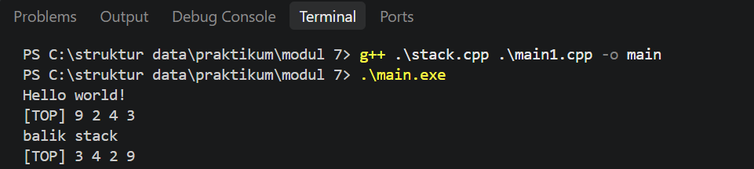
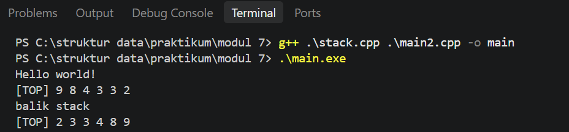
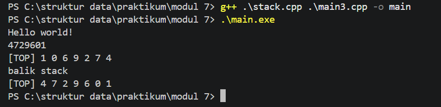

# <h1 align="center">Laporan Praktikum Modul 7 - STACK</h1>
<p align="center">Zuhra Hanani Ramadhina - 109082500143</p>

## Dasar Teori


## Guided 

### 1. stack.h

```C++
/* file : stack.h
   contoh ADT stack dengan representasi tabel */
#ifndef STACK_H_INCLUDED
#define STACK_H_INCLUDED

#include <iostream>
using namespace std;

struct infotype {
    char nim[20];
    char nama[20];
};
struct Stack {
    infotype info[10];
    int Top;
};

/* prototype */
/******** pengecekan apakah Stack kosong *********/
int isEmpty(Stack S);
/* mengembalikan nilai 0 jika stack kosong */

/******** pembuatan Stack ********/
void createStack(Stack &S);
/* I.S. sembarang
   F.S. terbentuk stack dengan Top=0 */

/******** penambahan elemen pada Stack ********/
void push(Stack &S, infotype X);
/* I.S. Stack mungkin kosong
   F.S. menambahkan elemen pada stack dengan nilai X, TOP=TOP+1 */

/******** penghapusan elemen pada Stack ********/
void pop(Stack &S, infotype &X);
/* I.S. stack tidak kosong
   F.S. nilai info pada indeks TOP disimpan pada X, kemudian TOP=TOP-1 */

/******** proses semua elemen Stack *********/
void viewStack(Stack S);
/* I.S. stack mungkin kosong
   F.S. jika stack tidak kosong menampilkan semua info yang ada pada stack
*/
#endif // STACK_H_INCLUDED

```

### 2. stack.cpp

```C++
#include "stack.h"

int isEmpty(Stack S) {
    /* Top = 0 berarti kosong, sesuai komentar di stack.h dikembalikan 0 */
    if (S.Top == 0) {
        return 0;
    } else {
        return 1;
    }
}

void createStack(Stack &S) {
    S.Top = 0;
}

void push(Stack &S, infotype X) {
    if (S.Top < 10) {
        S.Top = S.Top + 1;
        S.info[S.Top - 1] = X;   /* Top 1..10 dipetakan ke indeks array 0..9 */
    } else {
        cout << "Stack penuh, data tidak bisa ditambahkan" << endl;
    }
}

void pop(Stack &S, infotype &X) {
    if (isEmpty(S) != 0) {
        X = S.info[S.Top - 1];
        S.Top = S.Top - 1;
    } else {
        cout << "Stack kosong, tidak ada data yang bisa diambil" << endl;
    }
}

void viewStack(Stack S) {
    if (isEmpty(S) == 0) {
        cout << "Stack kosong" << endl;
    } else {
        cout << "Isi stack (dari TOP):" << endl;
        for (int i = S.Top; i >= 1; i--) {
            cout << i << ". " << S.info[i - 1].nim << " - "
                 << S.info[i - 1].nama << endl;
        }
    }
}

```


### 3. main.cpp

```C++
#include <iostream>
#include <cstring>
#include "stack.h"
using namespace std;

int main() {
    Stack S;
    infotype data, hasil;

    createStack(S);
    cout << "Stack baru dibuat, Top = " << S.Top << endl;
    viewStack(S);

    cout << endl << "--- Push 3 data ---" << endl;
    strcpy(data.nim, "103112400001");
    strcpy(data.nama, "Andi");
    push(S, data);

    strcpy(data.nim, "103112400002");
    strcpy(data.nama, "Budi");
    push(S, data);

    strcpy(data.nim, "103112400003");
    strcpy(data.nama, "Citra");
    push(S, data);
    viewStack(S);

    cout << endl << "--- Pop 1 data ---" << endl;
    pop(S, hasil);
    cout << "Data yang diambil: " << hasil.nim << " - " << hasil.nama << endl;
    viewStack(S);

    cout << endl << "--- Pop sampai kosong ---" << endl;
    pop(S, hasil);
    pop(S, hasil);
    pop(S, hasil);
    viewStack(S);

    return 0;
}

```

## Unguided 

### 1. ADT Stack dengan Array
#### Source Code stack.h
```C++
#ifndef STACK_H
#define STACK_H

#include <iostream>
using namespace std;

typedef int infotype;

struct Stack {
    infotype info[20];
    int top;
};

void createStack(Stack &S);
void push(Stack &S, infotype x);
infotype pop(Stack &S);
void printInfo(Stack S);
void balikStack(Stack &S);

void pushAscending(Stack &S, infotype x);
void getInputStream(Stack &S);

#endif
```
File header ini mendefinisikan ADT Stack menggunakan array. `infotype` adalah alias dari `int`, dan struct `Stack` berisi array `info` berkapasitas 20 elemen serta variabel `top` yang menunjukkan indeks elemen teratas. File ini juga mendeklarasikan prototipe prosedur dan fungsi yang dipakai, yaitu `createStack`, `push`, `pop`, `printInfo`, dan `balikStack` untuk soal 1, serta `pushAscending` dan `getInputStream` untuk soal 2 dan 3.

#### Source Code stack.cpp
```C++
#include "stack.h"

void createStack(Stack &S) {
    S.top = -1;
}

void push(Stack &S, infotype x) {
    if (S.top < 19) {
        S.top++;
        S.info[S.top] = x;
    } else {
        cout << "Stack penuh!" << endl;
    }
}

infotype pop(Stack &S) {
    if (S.top == -1) {
        cout << "Stack kosong!" << endl;
        return -1;
    }
    infotype x = S.info[S.top];
    S.top--;
    return x;
}

void printInfo(Stack S) {
    cout << "[TOP] ";
    for (int i = S.top; i >= 0; i--) {
        cout << S.info[i] << " ";
    }
    cout << endl;
}

void balikStack(Stack &S) {
    int i = 0;
    int j = S.top;
    while (i < j) {
        infotype temp = S.info[i];
        S.info[i] = S.info[j];
        S.info[j] = temp;
        i++;
        j--;
    }
}

void pushAscending(Stack &S, infotype x) {
    if (S.top >= 19) {
        cout << "Stack penuh!" << endl;
        return;
    }
    int i = S.top;
    while (i >= 0 && S.info[i] > x) {
        S.info[i + 1] = S.info[i];
        i--;
    }
    S.info[i + 1] = x;
    S.top++;
}

void getInputStream(Stack &S) {
    char c = cin.get();
    while (c != '\n') {
        if (c >= '0' && c <= '9') {
            push(S, c - '0');
        }
        c = cin.get();
    }
}
```
File ini mengimplementasikan seluruh operasi stack. `createStack()` membuat stack kosong dengan mengisi `top` dengan -1. `push()` menaikkan `top` lalu menyimpan elemen baru di posisi tersebut, dengan pengecekan agar tidak melebihi kapasitas 20. `pop()` mengambil elemen di posisi `top` lalu menurunkan `top`, dan mengembalikan nilai elemen yang diambil. `printInfo()` menampilkan isi stack dari `top` turun ke indeks 0, sehingga elemen yang terakhir dimasukkan tampil paling depan. `balikStack()` membalik urutan isi stack dengan menukar elemen dari ujung depan dan ujung belakang array hingga bertemu di tengah. Prosedur `pushAscending()` menyisipkan elemen baru ke posisi yang tepat dengan menggeser elemen yang lebih besar satu indeks ke atas, sehingga isi stack selalu terurut naik dari dasar ke `top`. Prosedur `getInputStream()` membaca input karakter demi karakter menggunakan `cin.get()` sampai user menekan enter, dan setiap karakter angka diubah menjadi nilai integer (`c - '0'`) lalu dimasukkan dengan `push()`.

#### Source Code main1.cpp
```C++
#include "stack.h"

int main() {
    cout << "Hello world!" << endl;
    Stack S;
    createStack(S);
    push(S, 3);
    push(S, 4);
    push(S, 8);
    pop(S);
    push(S, 2);
    push(S, 3);
    pop(S);
    push(S, 9);
    printInfo(S);
    cout << "balik stack" << endl;
    balikStack(S);
    printInfo(S);
    return 0;
}
```
Program membuat stack kosong lalu menjalankan urutan operasi push dan pop. Setelah push 3, 4, dan 8, `pop()` membuang elemen teratas (8), kemudian push 2 dan 3, `pop()` membuang 3 lagi, dan terakhir push 9, sehingga isi stack dari dasar ke top adalah 3, 4, 2, 9. `printInfo()` menampilkannya dari top, yaitu `9 2 4 3`. Setelah `balikStack()`, urutannya terbalik dan ditampilkan menjadi `3 4 2 9`.

### Output Unguided 1 :

##### Output 


### 2. pushAscending

#### Source Code main2.cpp
```C++
#include "stack.h"

int main() {
    cout << "Hello world!" << endl;
    Stack S;
    createStack(S);
    pushAscending(S, 3);
    pushAscending(S, 4);
    pushAscending(S, 8);
    pushAscending(S, 2);
    pushAscending(S, 3);
    pushAscending(S, 9);
    printInfo(S);
    cout << "balik stack" << endl;
    balikStack(S);
    printInfo(S);
    return 0;
}
```
Program memasukkan enam angka (3, 4, 8, 2, 3, 9) menggunakan `pushAscending()` alih-alih `push()` biasa. Setiap angka disisipkan pada posisi yang menjaga urutan naik dari dasar ke top, sehingga isi akhir stack adalah 2, 3, 3, 4, 8, 9. Karena `printInfo()` menampilkan dari top, hasilnya `9 8 4 3 3 2`. Setelah `balikStack()`, hasilnya menjadi `2 3 3 4 8 9`.

### Output Unguided 2 :

#### Output


### 3. getInputStream

#### Source Code main3.cpp
```C++
#include "stack.h"

int main() {
    cout << "Hello world!" << endl;
    Stack S;
    createStack(S);
    getInputStream(S);
    printInfo(S);
    cout << "balik stack" << endl;
    balikStack(S);
    printInfo(S);
    return 0;
}
```
Program memanggil `getInputStream()` yang membaca input user per karakter hingga enter ditekan, dan memasukkan tiap angka ke stack. Untuk input `4729601`, angka dimasukkan berurutan dari 4 sampai 1, sehingga angka terakhir (1) berada di top dan `printInfo()` menampilkan `1 0 6 9 2 7 4`. Setelah `balikStack()`, urutannya kembali seperti input, yaitu `4 7 2 9 6 0 1`.

### Output Unguided 3 :

#### Output


## Kesimpulan


## Referensi

